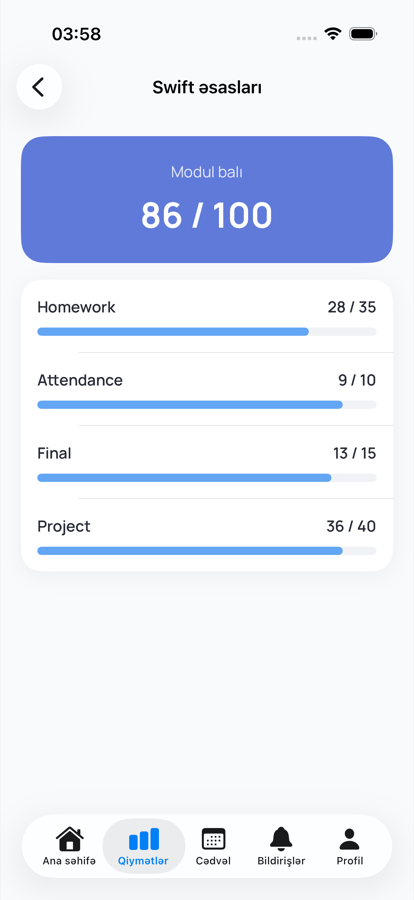
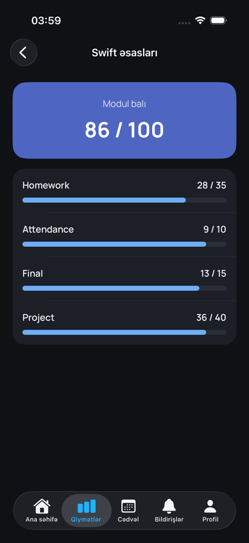

# ABB Campus

[](https://github.com/Ceyhun1999/abb_campus/actions/workflows/tests.yml)

ABB Campus is an iOS app for students, teachers and staff of the ABB academy.
Students see their next lesson, grades, attendance, schedule and announcements in one place.
Employees (academy staff) manage students, groups, teachers and announcements, and can import a whole group of students from an Excel file.

The app works with a Laravel REST API (`https://campus.jeywastudio.com/api`).

## Screenshots

### Employee

| Dashboard | Students | Group | Excel import |
| --- | --- | --- | --- |
|  |  |  |  |
|  |  |  |  |

### Student

| Home | Grades | Module | Schedule | Attendance | Notifications |
| --- | --- | --- | --- | --- | --- |
|  |  |  |  |  |  |
|  |  |  |  |  |  |

### Sign in

| Role selection | Login | Forgot password | Profile |
| --- | --- | --- | --- |
|  |  |  |  |
|  |  |  |  |

## Features

- **Role selection.** The user chooses Student, Teacher or Employee before signing in.
- **Login.** Validation runs in the view model, server errors come back in Azerbaijani, and the last used email is remembered.
- **Forgot password.** A sheet with three steps: email → 6-digit code → new password.
- **Session persistence.** The token is stored in the Keychain and restored on launch through `/auth/me`. Expired tokens are removed.
- **Student home.** Shows the next lesson from the schedule, the average score, attendance and the latest announcements, all loaded in parallel with `async let`. The attendance card opens the full attendance history.
- **Grades (student).** Shows the average and overall score, a progress bar for each module, and the category breakdown of a module (Homework, Final, Project…).
- **Schedule (student).** Upcoming or past lessons grouped by day, with time and room.
- **Notifications (student).** Announcements for all students and for the student's own group.
- **Profile.** Shows the user's details and signs out (with confirmation) through `/auth/logout`.
- **Employee dashboard.** Shows the number of students, teachers, groups and announcements, plus the latest announcements.
- **Students (employee).** Search by name, email or group, filter by All / Active / Inactive, open details, and activate or deactivate an account.
- **Groups (employee).** Search groups, see study progress, create a group in a sheet (course, teacher, dates), and open a group to see its students.
- **Excel import.** Pick an `.xlsx`, `.xls` or `.csv` file with `first_name, last_name, email` columns. It is uploaded as multipart form data, and the screen shows how many rows were added, how many were skipped, and the error for each skipped row.
- **Teachers.** See the list with specialty and group count, and open a teacher to see their groups.
- **Announcements.** See the list, and publish a new one to everyone, all students, all teachers or a single group (500 character limit).
- **Dark mode.** Every color comes from the asset catalog and has a dark variant.
- **Loading, error and empty states.** Every screen uses one shared `AsyncContentView` driven by a `ViewState` enum, with retry on error and pull-to-refresh.

## Tech stack

| Area | Used |
| --- | --- |
| UI | SwiftUI, custom Manrope font |
| Architecture | MVVM + Services, protocol-based dependency injection |
| State management | Observation (`@Observable`, `@State`, `@Bindable`, `@Environment`) |
| Networking | `URLSession` with `async/await`, generic `NetworkService`, typed `Endpoint`s, bearer token injection, multipart upload |
| Navigation | `NavigationStack` with value-based `navigationDestination`, `sheet`, `TabView`, `confirmationDialog`, `fileImporter`, `searchable` |
| Persistence | Keychain (auth token), `UserDefaults` (last login email) |
| Testing | Swift Testing (unit tests), XCTest / XCUITest (UI tests) |
| CI | GitHub Actions: every push and pull request runs all tests |

## Architecture

```
View  ──▶  ViewModel  ──▶  Service (protocol)  ──▶  NetworkService  ──▶  REST API
                │
                └──▶  AuthenticationState  ──▶  SecureStorage (Keychain)
```

- **Views** only render state and forward user actions. They have no business logic, networking or validation.
- **ViewModels** (`@Observable`, `@MainActor`) hold screen state, validate input and call services.
- **Services** describe API operations behind protocols: `AuthService`, `PasswordResetService`, `EmployeeDashboardService`, `StudentDirectoryService`, `TeacherService`, `GroupService` and `AnnouncementService`. `Default…` types implement them with the `NetworkService`.
- **TokenStore** holds the access token. Endpoints marked `requiresAuthorization` get the `Bearer` header from the network service, so views and view models never deal with tokens.
- **AuthenticationState** is the single source of truth for the signed-in user. It is shared through the SwiftUI environment.
- **AppDependencies** is the composition root. It builds the live services. When the app is launched with `-ui-testing`, it uses in-memory stub services instead.

```
abb_campus/
├── App/            # App entry point, AppDependencies, UI-testing stubs
├── Core/           # Networking, Keychain, UserDefaults, auth state, helpers, extensions
├── Models/         # Codable API models
├── Services/       # AuthService, PasswordResetService
├── ViewModels/     # One view model per screen
├── Features/       # Screens grouped by feature, with their own components
├── Shared/         # Reusable UI components (PrimaryButton, IconCircleView, ProgressBar…)
├── Root/           # RootView: decides between login, loading and the main app
└── Resources/      # Fonts
abb_campusTests/    # Unit tests + mocks
abb_campusUITests/  # UI tests
```

## Tests

- **Unit tests** (`abb_campusTests`, 72 tests) cover the auth view models (`LoginViewModel`, `ForgotPasswordViewModel`, `RoleSelectionViewModel`), `ProfileViewModel`, all student view models (home with next-lesson selection, grades, module grades, schedule grouping, attendance, notifications), all employee view models (dashboard, students list and detail, group detail, create group, Excel import, new announcement), `AuthenticationState`, `ValidationHelper` and request building for `EmployeeEndpoint`. They check both success and error cases. Every service is replaced by a mock through its protocol, so the tests never call the real API.
- **UI tests** (`abb_campusUITests`) cover the login flow (role selection, the validation error, the wrong password error, a successful login → home → logout, and opening the forgot password sheet) the student flow (home → attendance, grades → module details) and the employee flow (dashboard → students → Inactive filter → student details, and group → import screen). The app starts with `-ui-testing`, so the tests use stub services.

Run all tests from the terminal:

```bash
xcodebuild test \
  -project abb_campus.xcodeproj \
  -scheme abb_campus \
  -destination 'platform=iOS Simulator,name=iPhone 17'
```

Or run them in Xcode with **⌘U**.

## How to run

Requirements:
- Xcode 26 or newer
- iOS 17.0+ simulator or device

Steps:
1. `git clone https://github.com/Ceyhun1999/abb_campus.git`
2. Open `abb_campus.xcodeproj`.
3. Select the `abb_campus` scheme and a simulator, then press **⌘R**.

Demo accounts (password `Password123!` for all of them):

| Role | Email |
| --- | --- |
| Student | `student@abb.local` |
| Employee | `employee@abb.local` |
| Teacher | `teacher@abb.local` |

To try the Excel import, drag the files from [`docs/demo`](docs/demo) onto the simulator and save them in Files. Then open a group, choose **Excel-dən tələbə idxal et** and pick a file. The import is all or nothing: [`telebeler.xlsx`](docs/demo/telebeler.xlsx) is valid and adds 6 students (including `student@abb.local`), while [`telebeler_sehvli.xlsx`](docs/demo/telebeler_sehvli.xlsx) has 3 invalid rows, so nothing is imported and the errors are listed.

## Backend

The app talks to a Laravel 12 REST API. For the employee screens these endpoints were added: `GET /employee/dashboard`, `GET /students`, `GET /students/{id}`, `GET /teachers`, `GET /teachers/{id}` and `PATCH /users/{id}/status`, plus search on `GET /groups`. While building the student screens, three existing backend bugs were fixed: attendance was always 0%, ungraded modules lowered the average, and the group students list returned a 500 error. Everything is covered by PHPUnit feature tests (28 tests).
