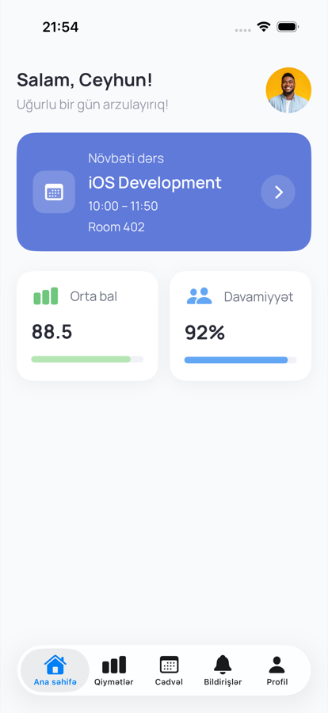
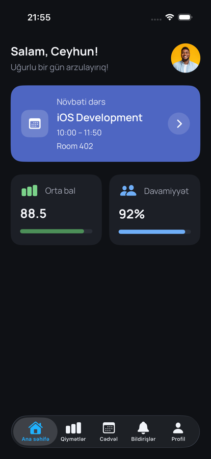

# ABB Campus

[](https://github.com/Ceyhun1999/abb_campus/actions/workflows/tests.yml)

ABB Campus is an iOS app for students, teachers and staff of the ABB academy.
Students see their next lesson, grades, attendance, schedule and announcements in one place.
Teachers and employees will manage their groups from the same app.

The app works with a Laravel REST API (`https://campus.jeywastudio.com/api`).

## Screenshots

| Role selection | Login | Forgot password | Home | Profile |
| --- | --- | --- | --- | --- |
|  |  |  |  |  |
|  |  |  |  |  |

## Features

- **Role selection.** The user chooses Student, Teacher or Employee before signing in.
- **Login.** Validation runs in the view model, server errors come back in Azerbaijani, and the last used email is remembered.
- **Forgot password.** A sheet with three steps: email → 6-digit code → new password.
- **Session persistence.** The token is stored in the Keychain and restored on launch through `/auth/me`. Expired tokens are removed.
- **Student area.** A `TabView` with Home, Grades, Schedule, Notifications and Profile tabs.
- **Profile.** Shows the user's details and signs out (with confirmation) through `/auth/logout`.
- **Dark mode.** Every color comes from the asset catalog and has a dark variant.
- **Loading and error states.** Shown on all network actions.

## Tech stack

| Area | Used |
| --- | --- |
| UI | SwiftUI, custom Manrope font |
| Architecture | MVVM + Services, protocol-based dependency injection |
| State management | Observation (`@Observable`, `@State`, `@Bindable`, `@Environment`) |
| Networking | `URLSession` with `async/await`, generic `NetworkService`, typed `Endpoint`s |
| Navigation | `NavigationStack`, `navigationDestination`, `sheet`, `TabView`, `confirmationDialog` |
| Persistence | Keychain (auth token), `UserDefaults` (last login email) |
| Testing | Swift Testing (unit tests), XCTest / XCUITest (UI tests) |
| CI | GitHub Actions: every push and pull request runs all tests |

## Architecture

```
View  ──▶  ViewModel  ──▶  Service (protocol)  ──▶  NetworkService  ──▶  REST API
                │
                └──▶  AuthenticationState  ──▶  SecureStorage (Keychain)
```

- **Views** only render state and forward user actions. They have no business logic, networking or validation.
- **ViewModels** (`@Observable`, `@MainActor`) hold screen state, validate input and call services.
- **Services** (`AuthService`, `PasswordResetService`) describe API operations behind protocols. `Default…` types implement them with the `NetworkService`.
- **AuthenticationState** is the single source of truth for the signed-in user. It is shared through the SwiftUI environment.
- **AppDependencies** is the composition root. It builds the live services. When the app is launched with `-ui-testing`, it uses in-memory stub services instead.

```
abb_campus/
├── App/            # App entry point, AppDependencies, UI-testing stubs
├── Core/           # Networking, Keychain, UserDefaults, auth state, helpers, extensions
├── Models/         # Codable API models
├── Services/       # AuthService, PasswordResetService
├── ViewModels/     # One view model per screen
├── Features/       # Screens grouped by feature, with their own components
├── Shared/         # Reusable UI components (PrimaryButton, IconCircleView, ProgressBar…)
├── Root/           # RootView: decides between login, loading and the main app
└── Resources/      # Fonts
abb_campusTests/    # Unit tests + mocks
abb_campusUITests/  # UI tests
```

## Tests

- **Unit tests** (`abb_campusTests`) cover `LoginViewModel`, `ForgotPasswordViewModel`, `RoleSelectionViewModel`, `ProfileViewModel`, `StudentHomeViewModel`, `AuthenticationState` and `ValidationHelper`. They check both success and error cases. Every service is replaced by a mock through its protocol, so the tests never call the real API.
- **UI tests** (`abb_campusUITests`) cover the login flow: role selection, the validation error, the wrong password error, a successful login → home → logout, and opening the forgot password sheet. The app starts with `-ui-testing`, so the tests use stub services.

Run all tests from the terminal:

```bash
xcodebuild test \
  -project abb_campus.xcodeproj \
  -scheme abb_campus \
  -destination 'platform=iOS Simulator,name=iPhone 17'
```

Or run them in Xcode with **⌘U**.

## How to run

Requirements:
- Xcode 26 or newer
- iOS 17.0+ simulator or device

Steps:
1. `git clone https://github.com/Ceyhun1999/abb_campus.git`
2. Open `abb_campus.xcodeproj`.
3. Select the `abb_campus` scheme and a simulator, then press **⌘R**.

Demo account: `student@abb.local` / `Password123!` (role: Student).
